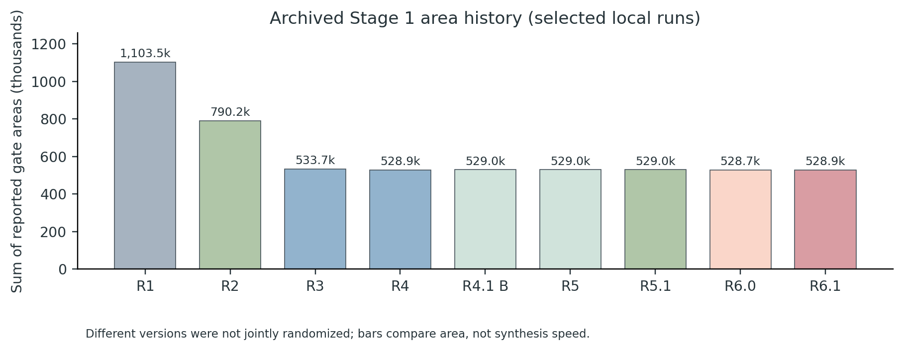

# Truth Table to Circuit
### Timing-Constrained Boolean Logic Synthesis · UFUG2106 Discrete Mathematics

A research and implementation archive for constructing **functionally equivalent, area-efficient, timing-feasible multi-output combinational circuits** from complete Boolean truth tables.

**Course:** UFUG2106 Discrete Mathematics · The Hong Kong University of Science and Technology (Guangzhou)  
**Authors:** Jincan LI · Zeyun DU (Group 2)  
**Implementation:** C++17 · Python for testing, analysis, and visualization  
**Status:** Stage 1 completed; Stage 2 not yet documented

**Start here:** [Technical Report (PDF)](UFUG2106_Stage1_Writing_v1_0/technical_report/main.pdf) · [Research Trial Log (PDF)](UFUG2106_Stage1_Writing_v1_0/trial_log_record/main.pdf) · [Round 5.1 source](UFUG2106_Round5.1_Delivery/src/synth_round51.cpp) · [Development history](#research-development-rounds) · [Build & reproduce](#build-and-reproduce)

---

## 1. Problem and objective

A complete truth table specifies the outputs of a Boolean function, but not an efficient physical realization. Direct minterm expansion can reproduce any table, yet tends to duplicate intermediate expressions and introduce unnecessary gate area and path delay.

**Stage 1** asks us to synthesize an acyclic, topologically ordered **gate DAG** from a complete truth table, supporting multiple output functions, instance-specific area/delay costs, and a critical-delay target.

Only three gate primitives are allowed:

| Gate | Function |
|---|---|
| `AND2` | Two-input conjunction |
| `OR2` | Two-input disjunction |
| `NOT` | One-input complement |

The **circuit area** is the sum of priced *live* gates. Its **delay** is the maximum arrival time over outputs, computed using the given gate-delay costs. Shared intermediate nodes may reduce area across outputs, but create dependencies that a local rewrite must account for.

The practical objectives are:

1. Preserve **exact Boolean equivalence** at every output.
2. Meet the **specified delay target**, while reducing mapped gate area.
3. Limit the **computational cost of synthesis** itself.

The course evaluator measures correctness, target satisfaction, area, circuit delay, and synthesis runtime separately. The actual grading function is not assumed.

## 2. Main Stage 1 result

The selected **research-frozen implementation is Round 5.1**. It met all timing targets on the 25 released Stage 1 cases and significantly reduced total area relative to our first ROBDD baseline.

| Metric | Round 1 | **Round 5.1** |
|---|---:|---:|
| Functional PASS | 25/25 | **25/25** |
| Delay target met | 12/25 | **25/25** |
| Aggregate gate area | 1,103,455 | **529,014** |
| Change in aggregate area | — | **−52.1%** |
| Median synthesis runtime (selected archived WSL run) | 5.455 ms | 55.488 ms |

The baseline was deliberately simple: the area decrease does **not** establish global minimum area, and the more sophisticated search has a runtime cost.

The chart is derived from [archived round-history data](UFUG2106_Stage1_Writing_v1_0/shared/data/round_history.csv). More informative than independent historical timings are the **two paired WSL comparisons** of Round 5 against Round 5.1, each with identical total area and per-case delay:

| Paired experiment | Round 5 median | Round 5.1 median | Runtime change |
|---|---:|---:|---:|
| Run 1 | 72.188 ms | 55.488 ms | −23.13% |
| Run 2 | 60.827 ms | 55.077 ms | −9.45% |

Data: [paired benchmark CSV](UFUG2106_Stage1_Writing_v1_0/shared/data/paired_benchmarks.csv). The historical medians below are **not all measured in the same paired experiment** and should not be interpreted as a controlled speed ranking.

## 3. Algorithm: from a truth table to a shared gate DAG

### 3.1 Shannon decomposition and ROBDDs

The construction begins with **Shannon expansion**: recursively split a Boolean function by one variable into two cofactors, then reconstruct the function using a multiplexer-like decomposition. A **reduced ordered binary decision diagram (ROBDD)** merges equivalent subfunctions and removes redundant decisions.

This gives an exact symbolic representation and a reliable functional baseline. However, the number of BDD nodes does not directly equal the area of a mapped `AND2`/`OR2`/`NOT` circuit. Variable ordering, cofactor sharing, and gate polarity have a substantial effect on the output network.

### 3.2 Candidate portfolio and technology mapping

Instead of committing to one representation, the synthesizer explores alternative variable orders, Shannon-based constructions, and selected two-level SOP/POS forms. Each completed candidate is mapped to the permitted gate set, with **structural hashing** to share identical gates across logic cones and outputs.

The portfolio addresses a central observation: **different truth tables favor different decompositions**. The smallest symbolic representation is not necessarily the best final gate circuit.

### 3.3 Timing-aware mapped-network optimization

After mapping, the algorithm can improve the *actual* gate DAG:

- **Associative rebalancing** restructures AND/OR trees to shorten important paths.
- **Complemented/polarity-aware mapping** explores De Morgan equivalents and reuse of inverted signals.
- **Algebraic rewriting and area recovery** consider factoring, absorption, and alternative local realizations.
- **Required-time and slack analysis** reject transformations that would violate the delay constraint.
- **Exact live-DAG scoring** accounts for dead-gate pruning and sharing before accepting a proposed change.

A naive local gate-count reduction is insufficient: shared ancestors and downstream outputs can change which gates remain live. The [Technical Report](UFUG2106_Stage1_Writing_v1_0/technical_report/main.pdf) develops the mathematical construction, invariants, and acceptance criteria.

### 3.4 Round 5.1: typed, in-memory DAG processing

Round 5.1 accelerates the main post-mapping **rebalancing** and **area recovery** stages by replacing repeated intermediate netlist parsing/serialization with a typed in-memory gate representation.

Gate nodes carry an operation and fanin indices; arrival times are computed incrementally when nodes are created. Structural hash-consing avoids duplicate gates, and a complete live-DAG evaluation determines final candidate area and delay.

**Scope of the claim:** this is an engineering optimization, not a new Boolean identity or a completely text-free synthesis pipeline. Some final alternatives still use legacy representations; global area is not maintained by a purely local incremental counter.

Source: [`synth_round51.cpp`](UFUG2106_Round5.1_Delivery/src/synth_round51.cpp) · [`typed_netgraph.hpp`](UFUG2106_Round5.1_Delivery/src/typed_netgraph.hpp) · [mathematical design](UFUG2106_Round5.1_Delivery/docs/ROUND5_1_MATHEMATICAL_DESIGN.md)

### 3.5 Experimental cut rewriting (Rounds 6.0 and 6.1)

Additional work investigated **four-feasible-cut rewriting**. For each bounded local cut, the engine evaluates a small truth function over formal cut inputs, constructs alternative SOP/POS/factored candidates, and accepts only globally feasible improvements.

Round 6.1 added caching of symbolic covers and a time budget to reduce repeated local search. Although both variants lowered area slightly on the released cases, the additional synthesis time outweighed those savings under our research selection criteria. **They are archived as experiments; Round 5.1 remains the default research freeze.**

Read [Round 6.0 design](UFUG2106_Round6.0_Prototype/docs/ROUND6_0_MATHEMATICAL_DESIGN.md) and [Round 6.1 design](UFUG2106_Round6.1_Delivery/docs/ROUND6_1_MATHEMATICAL_DESIGN.md) for the cut formalism and experiments.

## 4. Research development rounds

The following values come from **selected archived WSL Stage 1 evaluations**. Each row represents one recorded round, not one simultaneous nine-way controlled run.

| Round | Main change | PASS | Target met | Area sum | Median runtime |
|---|---|---:|---:|---:|---:|
| [1](UFUG2106_Round1_Delivery/) | Fixed-order ROBDD correctness baseline | 25/25 | 12/25 | 1,103,455 | 5.455 ms |
| [2](UFUG2106_Round2_Delivery/) | BDD / Shannon / implicant representation portfolio | 25/25 | 25/25 | 790,243 | 36.427 ms |
| [3](UFUG2106_Round3_Delivery/) | Complemented-edge mapping, balance, timing-aware recovery | 25/25 | 25/25 | 533,705 | 68.486 ms |
| [4](UFUG2106_Round4_Delivery/) | Polarity and algebraic mapped-network optimization | 25/25 | 25/25 | 528,910 | 127.568 ms |
| [4.1 Balanced](UFUG2106_Round4.1_Delivery/) | Runtime/quality trade-off variants | 25/25 | 25/25 | 529,014 | 102.615 ms |
| [5](UFUG2106_Round5_Delivery/) | Caching, candidate pruning, lighter metric collection | 25/25 | 25/25 | 529,014 | 68.861 ms |
| **[5.1](UFUG2106_Round5.1_Delivery/)** | **Typed in-memory DAG and incremental arrival tracking** | **25/25** | **25/25** | **529,014** | **55.488 ms** |
| [6.0](UFUG2106_Round6.0_Prototype/) | Bounded four-input-cut rewriting | 25/25 | 25/25 | 528,738 | 114.610 ms |
| [6.1](UFUG2106_Round6.1_Delivery/) | Cached, budgeted cut rewriting | 25/25 | 25/25 | 528,854 | 80.731 ms |

**Interpretation:** Round 2 solved baseline delay infeasibility. Round 3 delivered the largest further area gain. Round 4 achieved slightly lower area with greater search cost. Rounds 4.1–5.1 improved the implementation efficiency while keeping almost all the area benefit. Rounds 6.0–6.1 explored a real but costly additional optimization direction.

See the [Round History](UFUG2106_Stage1_Writing_v1_0/shared/data/round_history.csv), [paired WSL results](UFUG2106_Stage1_Writing_v1_0/shared/data/paired_benchmarks.csv), and each delivery's `results/` and `local_runs/` for case-level evidence.

## 5. Where to find things

We retain the **original round-by-round directories at repository root**. Stage 1 and Stage 2 are identified here, not separated into artificial top-level stage folders.

| Path | Contents |
|---|---|
| [`Final Project (Tentative).pdf`](Final%20Project%20%28Tentative%29.pdf) | Project handout and task definition |
| [`baseline/`](baseline/) | Early BDD baseline |
| [`UFUG2106_Round*_Delivery/`](UFUG2106_Round1_Delivery/) | Historical C++ implementations, design documents, results and reproduction logs (Rounds 1–5.1, 6.1) |
| [`UFUG2106_Round6.0_Prototype/`](UFUG2106_Round6.0_Prototype/) | Experimental cut-rewrite branch |
| [`UFUG2106_Round5.1_Delivery/src/`](UFUG2106_Round5.1_Delivery/src/) | Main selected synthesis source |
| [`UFUG2106_Stage1_Round5.1_Freeze_20261111/`](UFUG2106_Stage1_Round5.1_Freeze_20261111/) | Frozen source snapshot, verification and benchmark evidence |
| [`UFUG2106_Stage1_Writing_v1_0/`](UFUG2106_Stage1_Writing_v1_0/) | Technical paper, long-form trial log, figures, BibTeX, data, scripts |
| [`data/stage1/`](data/stage1/) | Released Stage 1 truth tables |
| [`learning/`](learning/) | Supplementary logic-synthesis study notes |

### Two complementary papers

| Artifact | Reading purpose |
|---|---|
| **[Stage 1 Technical Report v1.0 (PDF)](UFUG2106_Stage1_Writing_v1_0/technical_report/main.pdf)** · [LaTeX source](UFUG2106_Stage1_Writing_v1_0/technical_report/main.tex) | Problem formulation, exact constructions, mapping, invariants, ablations, results and limitations |
| **[Trial Log & Research Development Record v1.0 (PDF)](UFUG2106_Stage1_Writing_v1_0/trial_log_record/main.pdf)** · [LaTeX source](UFUG2106_Stage1_Writing_v1_0/trial_log_record/main.tex) | Motivation for each experiment, mathematical derivations, alternative approaches, negative results and adoption decisions |

Read the **Technical Report** to understand the final algorithm and evidence. Read the **Trial Log** to understand why the project evolved as it did.

## 6. Build and reproduce

### Environment

- Linux / WSL2 and `g++` or another C++17-capable compiler
- `make` and Python 3
- The provided evaluator and truth tables for reproducing the released 25-case experiment
- Optional: a LaTeX installation with `pdflatex` and BibTeX for rebuilding the papers

### Build Round 5.1 and verify one case

From the repository root:

~~~bash
cd UFUG2106_Round5.1_Delivery
make

./build/synth_round51 ../data/stage1/case_001.txt /tmp/round51_case001.net

python3 tools/verify_netlist.py \
  ../data/stage1/case_001.txt \
  /tmp/round51_case001.net
~~~

The Makefile also builds `build/synth_reference`, the frozen Round 5 comparator. The synthesizer writes a **gate netlist**, not a rendered schematic image.

### Evaluate all released Stage 1 cases

From the **repository root**, after building:

~~~bash
./evaluator \
  ./UFUG2106_Round5.1_Delivery/build/synth_round51 \
  ./data/stage1 \
  --report /tmp/round51_metrics.csv
~~~

For the more complete paired reproduction with independent verification, holdout regression, source checksums and report-ready evidence:

~~~bash
cd UFUG2106_Round5.1_Delivery
bash run_round5_1_local.sh ../evaluator ../data/stage1
~~~

This runner follows the [Round 5.1 delivery procedure](UFUG2106_Round5.1_Delivery/README.md). The source is also preserved in the [Stage 1 frozen snapshot](UFUG2106_Stage1_Round5.1_Freeze_20261111/). Research source freezing should not be confused with independently verifying the exact file eventually uploaded to a course submission portal.

### Rebuild the research papers

~~~bash
cd UFUG2106_Stage1_Writing_v1_0

bash build_papers.sh
python3 shared/scripts/make_figures.py
~~~

The [shared materials](UFUG2106_Stage1_Writing_v1_0/shared/) include figure-generation code, source CSVs, references, synthetic holdout generators, manifests, and additional verification scripts.

## 7. Key conclusions

- **Equivalence is necessary but not sufficient:** exact BDD-based construction can still yield expensive or slow circuits.
- **Representations are optimization choices:** different Shannon orders, two-level forms and mapped alternatives favor different functions.
- **Global sharing changes local economics:** a smaller local replacement does not always reduce the live network's total area.
- **Timing and area must be considered together:** required-time constraints determine whether a rewrite is feasible.
- **The synthesis algorithm also has a cost:** Round 6 shows that a circuit-quality improvement can be outweighed by the time needed to find it.

These points, together with the mathematical proofs and complete evaluation evidence, are expanded in the two papers linked above.

## 8. Status and contributors

**Stage 1:** completed; **Round 5.1 is the selected research freeze**, while Rounds 6.0–6.1 remain accessible as follow-up experiments.  
**Stage 2:** not yet represented by reported results. Future work will be added to **this same repository**, with its scope identified in the README.

Jincan LI and Zeyun DU initially explored possible synthesis strategies independently, then compared, reviewed and integrated the approaches. Generative AI was extensively used for C++ implementation, experimental automation, data integration, research support and manuscript development; the reports document the verification process and division of responsibility in more detail.

Measured values refer to the named released tests and archived runs; the project does not claim globally minimum gate area or predict unreleased Stage 2 performance.
