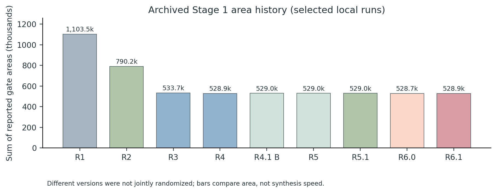

# Truth Table to Circuit

**UFUG2106 Discrete Mathematics · HKUST (Guangzhou)**  
**Stage 1–Stage 2 Boolean synthesis: source, experiments, and research reports**

**Contributors:** Jincan LI and Zeyun DU (Group 2)  
**Core implementation:** C++17 · **Evaluation/research tools:** Python 3, shell scripts, LaTeX

[**Quick Start**](QUICK_START.md) · [**Final Project Report (PDF)**](Stage%202%20Formal%20Report/main.pdf) · [**Unified Research Trial Log (PDF)**](Stage%202%20Formal%20Report/Research_Trial_Log/UFUG2106_Stage2_Research_Trial_Log_v3.pdf) · [**Final R10.0 source**](UFUG2106_Round10_0_Delivery/submission/synth.cpp) · [**Course specification**](Final_Project.pdf)

## Overview

The project synthesizes a **functionally equivalent, acyclic multi-output combinational circuit** from a complete Boolean truth table. The generated netlist uses only `AND2`, `OR2`, and `NOT` gates, and must respect per-instance gate costs and synthesis resource limits. The principal circuit-quality measures are:

- **Area:** sum of the given area costs of the emitted gates;
- **Circuit delay:** longest output-path delay under the given gate-delay costs;
- **Synthesis runtime / memory:** resources used by the synthesis *program*, not by the circuit.

Functional validity (`PASS`) and satisfaction of the target delay are distinct evaluator outcomes. The project does not assume an undisclosed grading formula or claim globally minimum circuit area.

This repository preserves both the **development process** and the **final Stage 2 solution**. The final method is a resource-aware synthesis pipeline that creates a legal candidate, maps alternative Boolean representations into a shared gate DAG, and then selectively applies bounded Boolean cut resynthesis under full-network area/timing acceptance checks.

## Final Stage 2 solver — R10.0

**Selected independent Stage 2 candidate:** [`UFUG2106_Round10_0_Delivery/submission/`](UFUG2106_Round10_0_Delivery/submission/) — `synth.cpp` plus the adjacent required headers. The complete delivery also contains a Makefile, tests, historical comparison sources, controlled experiments, and explanatory documents. R10.0 is the research-frozen solver analyzed in the Formal Report. It is **not represented as a verified teammate-integrated final release**, and unreleased grading cases have not been tested. Its historical delivery README retains its candidate-freeze wording for provenance.

### Main approach

1. **Exact construction and representation diversity:** build candidate circuits through Shannon/BDD-based plans and other available Boolean forms; detect simple structures where the time/resource budget warrants a specialized path.
2. **Cost-aware mapped network:** map to permitted gates, share reusable signals with structural hashing, and recover circuit timing/area on the output-reachable DAG.
3. **Bounded four-leaf rewriting:** represent cut functions by complete truth signatures; explore SOP- and Shannon-oriented alternatives subject to pruning and resource checks.
4. **Global selection and guarded refinement:** compare completed networks rather than accepting a purely local gate-count estimate. The ordinary default employs the R8.6 `extra_sop` selection and an optional R10.0 `repeat_sop` pass, accepted only for strict whole-network area reduction while meeting the target.
5. **Final serialization:** prune unused gates and produce a topologically ordered netlist. Short-limit and RAM-guarded cases may take different source-defined paths.

For formal definitions, pseudocode, correctness assumptions, implementation details and experimental results, see [`Stage 2 Formal Report/main.pdf`](Stage%202%20Formal%20Report/main.pdf) and its [LaTeX source](Stage%202%20Formal%20Report/main.tex).

### Public-case comparison

The report's **first matched public-bank evaluation repeat** compares the actually submitted Stage 1 solver (Z1) with R10.0 on the same 50 released truth tables (25 from each stage):

| Metric | Submitted Stage 1 (Z1) | Final Stage 2 (R10.0) |
|---|---:|---:|
| Functional PASS | 50/50 | **50/50** |
| Delay target met | 50/50 | **50/50** |
| Sum of weighted gate area | 1,144,244 | **1,019,547** |
| Net area change | — | **−124,697 (−10.90%)** |

R10.0 has smaller area on 18 cases and larger area on 32; the aggregate improvement is concentrated in a subset of cases. A second paired repeat confirmed the same direction of the per-case differences, while exact runtime and area values can vary with time-bounded search. The result is a **whole-solver comparison**, not a claim that the final SOP pass alone produced the aggregate gain.

Evidence: [`matched_case_metrics.csv`](Stage%202%20Formal%20Report/data/matched_case_metrics.csv), [numerical check](Stage%202%20Formal%20Report/verify.py), and the casewise appendix in the formal report. No hidden-case performance is claimed.

## Stage 1: an essential part of the project

Stage 1 includes two distinct contributions that the repository and reports keep separate:

- **Formally submitted Stage 1 solution (Z1):** developed by Zeyun Du and used as the actual submitted-method comparator in the final report. Its original source may be held in the separate peer-review materials, rather than the root delivery directories; see the report for provenance.
- **Independent Stage 1 research path (J51):** developed by Jincan Li across Rounds 1–6.1. The selected Round 5.1 research freeze achieved **25/25 PASS**, **25/25 delay targets met**, and **529,014 total area** on the released Stage 1 bank. Its typed-DAG and early cut-rewriting investigations contributed important design foundations for Stage 2.

See the [Stage 1 Technical Report](UFUG2106_Stage1_Writing_v1_0/technical_report/main.pdf), [Stage 1 Trial Log](UFUG2106_Stage1_Writing_v1_0/trial_log_record/main.pdf), and [Round 5.1 frozen evidence](Stage1_Freeze_Round5.1_Verified/).

### Stage 1 area and runtime trajectory

These figures are **selected historical WSL observations**, not a nine-way paired timing experiment. R5.1 is the preferred *research efficiency baseline*, not the formally submitted Z1 implementation.

| Research Round | PASS | Delay targets | Total area | Median synthesis time |
|---|---:|---:|---:|---:|
| R1 | 25/25 | 12/25 | 1,103,455 | 5.455 ms |
| R2 | 25/25 | 25/25 | 790,243 | 36.427 ms |
| R3 | 25/25 | 25/25 | 533,705 | 68.486 ms |
| R4 | 25/25 | 25/25 | 528,910 | 127.568 ms |
| R4.1 Balanced | 25/25 | 25/25 | 529,014 | 102.615 ms |
| R5 | 25/25 | 25/25 | 529,014 | 68.861 ms |
| **R5.1** | **25/25** | **25/25** | **529,014** | **55.488 ms** |
| R6.0 | 25/25 | 25/25 | 528,738 | 114.610 ms |
| R6.1 | 25/25 | 25/25 | 528,854 | 80.731 ms |

R5.1's typed in-memory DAG improved the R5 paired median by **23.13%** and **9.45%** in the two recorded reverse-order runs while retaining the same aggregate area and per-case delay. Its subsequent cut-rewriting experiments gained a small amount of area at additional search cost. See [paired evidence](UFUG2106_Stage1_Writing_v1_0/shared/data/paired_benchmarks.csv) and [archived round history](UFUG2106_Stage1_Writing_v1_0/shared/data/round_history.csv).

## Research evolution and evidence

The history is preserved as reproducible source, mathematical reasoning and controlled/archived evaluation evidence—not as a claim that each round was run simultaneously:

| Research interval | Main problem addressed |
|---|---|
| **R1–R3** | From an exact baseline to diversified, timing-aware mapped circuits |
| **R4–R5.1** | Better physical mapping and less synthesis overhead through typed-DAG operations |
| **R6.0–R6.1** | Initial bounded cut rewriting, with a real area–runtime trade-off |
| **[R7–R7.2](UFUG2106_Round7_2_Delivery/)** | Reduce short-budget failure risk and recover useful low-cost candidates |
| **[R8 prototype](UFUG2106_Round8_Prototype/) – [R8.7](UFUG2106_Round8_7_Delivery/)** | Four-leaf cut resynthesis, structural sharing, candidate order, guarded search, controlled SOP quotas |
| **[R9.0](UFUG2106_Round9_0_Delivery/) – [R9.1](UFUG2106_Round9_1_Delivery/)** | Short-limit screening, optional library versus Repeat SOP, source-only deployment controls |
| **[R10.0](UFUG2106_Round10_0_Delivery/) – [R10.1](UFUG2106_Round10_1_Delivery/)** | Freeze selected default; test reduced root caps and nominal budgets, retain R10.0 |

The [**unified Trial Log**](Stage%202%20Formal%20Report/Research_Trial_Log/UFUG2106_Stage2_Research_Trial_Log_v3.pdf) is the comprehensive research record: motivations, mathematical derivations, source changes, negative results, per-round decisions and cross-version visualizations. The [**Final Report**](Stage%202%20Formal%20Report/main.pdf) focuses on the *solution*, retaining only the historical comparisons needed to explain major design decisions.

## Repository guide

| Location | Role |
|---|---|
| [`Final_Project.pdf`](Final_Project.pdf) | Official project specification |
| [`data/stage1/`](data/stage1/), [`data/stage2/`](data/stage2/) | Released truth-table inputs (25 per bank) |
| [`UFUG2106_Round10_0_Delivery/`](UFUG2106_Round10_0_Delivery/) | **Selected research-frozen R10.0 implementation**, exact checking, experiments and evidence |
| [`UFUG2106_Round10_1_Delivery/`](UFUG2106_Round10_1_Delivery/) | Post-freeze budget-ablation experiment; **not** the selected final solver |
| [`UFUG2106_Round7_2_Delivery/`](UFUG2106_Round7_2_Delivery/), [`UFUG2106_Round8_6_Delivery/`](UFUG2106_Round8_6_Delivery/), [`UFUG2106_Round9_1_Delivery/`](UFUG2106_Round9_1_Delivery/) | Representative early, core and late Stage 2 iterations; all other named Round folders remain at root |
| [`Stage 2 Formal Report/`](Stage%202%20Formal%20Report/) | Canonical `main.tex`, `main.pdf`, data, figures, reproducibility scripts |
| [`Stage 2 Formal Report/Research_Trial_Log/`](Stage%202%20Formal%20Report/Research_Trial_Log/) | Complete integrated Stage 1–Stage 2 research log |
| [`UFUG2106_Stage1_Writing_v1_0/`](UFUG2106_Stage1_Writing_v1_0/) | Archived Stage 1 papers, figures, data and scripts |
| [`Stage1_Freeze_Round5.1_Verified/`](Stage1_Freeze_Round5.1_Verified/) | Stage 1 frozen research baseline and supporting evidence |
| [`Stage 2 Formal Report/UFUG2106_Final_Algorithm_Audit_v1/stage1_zeyun/`](Stage%202%20Formal%20Report/UFUG2106_Final_Algorithm_Audit_v1/stage1_zeyun/) | Archived Z1 submitted Stage 1 implementation and corresponding audit evidence |
| [`baseline/`](baseline/) | Early synthesis baseline |

Large duplicated reconstruction workspaces, old manuscript drafts, machine-generated build outputs and local backup archives are excluded from new Git commits by [`.gitignore`](.gitignore). Original per-round source, explanatory documents, and selected CSV/JSON evidence are retained. Local ZIP/RAR feedback bundles are ignored by default; normalized evidence tables are included. The archive documents observed public cases only.

## Build, test and reproduce

**First-time reader:** follow **[QUICK_START.md](QUICK_START.md)** to compile R10.0's independent `submission/` tree, synthesize and exhaustively verify one released case, run both 25-case public banks, and regenerate the final paper from tracked sources. The full R10.0 policy ablation runner is described in [its delivery README](UFUG2106_Round10_0_Delivery/README.md). To reproduce the earlier paired R5/R5.1 trials, use the [Stage 1 delivery guide](UFUG2106_Round5.1_Delivery/README.md).

The merged Trial Log is available as a complete PDF, and its CSV/plots explain iteration decisions. Its **editable LaTeX reconstruction** additionally requires the Stage 1/Stage 2 body sources, palette, figure set and merge scripts; see that log's own [README](Stage%202%20Formal%20Report/Research_Trial_Log/README.md).

## Research integrity and attribution

Jincan Li carried out the independent Stage 1 research line and the Stage 2 algorithm-development/implementation work documented here; Zeyun Du authored the formally submitted Stage 1 solver. The project's final report records individual contributions and any review/collaboration separately; this repository documentation does not retroactively reassign authorship of historical submissions. Generative AI tools were used for implementation assistance, experiment automation, data consolidation and manuscript support, with source inspection, numerical checks and verification documented in the project materials.

The public release is a **research and coursework archive**, not a formally verified synthesis engine or a promise of success on unreleased cases.

## Repository integrity and evidence scope

All named R7/R8/R9/R10 research-delivery directories and both public banks have been checked on GitHub `main`. The documentation and scientific values are based on archived results; source-defined time budgets are cooperative, not universal hard runtime bounds. Full reconstruction of the merged Trial Log requires its archived `tex/` bodies, `shared/palette.tex`, full referenced figure set, and merge/plot scripts in addition to the precompiled PDF.
